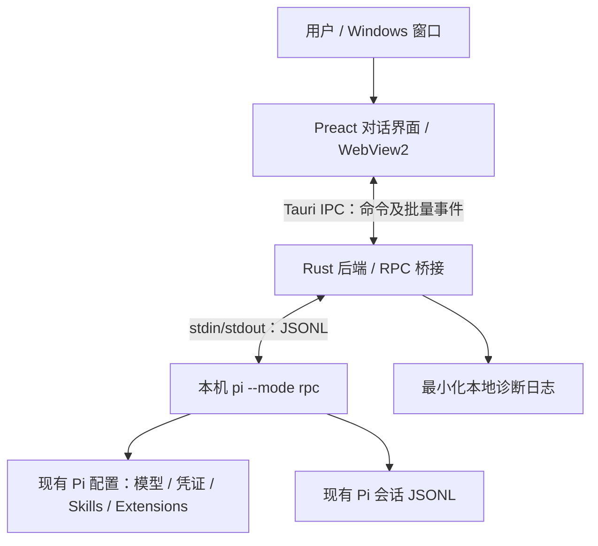

# Pi Pane — Windows 极简桌面客户端实现设计

> 状态：**实现基线 v0.2（M0–M3 功能范围已写入代码，Windows 实机验收待完成）**  
> 日期：2026-10-26  
> 首发平台：Windows 10/11 x64  
> 目标：**用本地 Pi 的全部可用 Agent 能力，提供尽量接近原生 TUI 的轻量 GUI，并解决 Markdown/代码复制的不便。**  
> 本文件是长期维护的设计基线；每次引入新功能或改变架构时，应同步更新「决策记录 / 路线图 / 已知限制」。

## 1. 产品定位与边界

Pi Pane **不是新的编程 Agent，也不是 IDE**，只是已安装的 Pi Coding Agent 的桌面交互窗口。

设计原则：

1. **Pi 为唯一事实来源**：模型、认证、工具、MCP、Skills、Extensions、上下文管理及会话持久化仍由本机 Pi 负责。
2. **仅替换 UI**：通过受控的本地 Pi RPC 子进程通信，不重写模型客户端或 Agent 调度逻辑。
3. **轻量、响应快**：系统 WebView2 + Rust 小型后端；不捆绑 Chromium/Electron，不常驻第二套 Node/Agent 服务。
4. **键盘优先，鼠标友好**：接近 Pi TUI 的输入、状态栏和工具消息；改进文本选择、Markdown、代码高亮与复制。
5. **保持真实的能力边界**：Pi RPC 不等于 TUI 像素级复刻；TUI 专用 Extension 组件需要单独兼容或回退原生 TUI。
6. **本地优先和最小权限**：无远端中转、无强制账号、默认不收集遥测；不复制或上传 Pi 凭证。

### 不在首版范围

内置编辑器、项目文件树、Git 工作台、Worktree 面板、Git Diff 审查器、多 Agent 编排、插件市场、云同步、浏览器远程控制、内置终端模拟器、自动运营平台、对 Pi 配置的独立编辑器。

允许展示 **Pi 已经产生** 的工具记录和代码片段，但不因此扩展成 IDE。

## 2. 技术选型

| 层 | 选型 | 理由 / 约束 |
| --- | --- | --- |
| 桌面框架 | **Tauri 2** | Windows 原生窗口；与 Electron 相比不随应用重复捆绑 Chromium |
| 页面引擎 | **系统 WebView2** | 使用 Windows 已安装运行时；首次运行检测，缺失时提示安装 |
| 后端 | **Rust + Tokio（仅所需特性）** | 管理子进程、JSONL、进程生命周期与文件选择；独立于 Agent |
| 前端 | **Preact + TypeScript + Vite** | 轻量组件和可控渲染；不使用大型 UI 框架 |
| 状态管理 | 局部组件状态 + 小型 store | 不额外引入 Redux 等全局状态框架 |
| Markdown | markdown-it，禁用原始 HTML | 正确显示正文、表格、代码围栏；防止不可信 HTML 执行 |
| 内容安全 | DOMPurify / 严格链接白名单 | 防止 XSS、危险链接和不可信富文本 |
| 代码高亮 | highlight.js 的 core + 按需语言 | 禁止一次加载全部语言；流式阶段按纯文本显示 |
| 样式 | 原生 CSS + CSS variables | 单一主题起步，系统字体，避免运行时 CSS-in-JS |
| IPC | Tauri command + event，结构化对象 | 有界消息、批处理更新；不暴露任意执行接口 |
| 会话 | **Pi 自身的 JSONL** | 不新增 SQLite 数据库，不另存一份会话真相 |
| 发布 | Windows NSIS 安装包 | 首版优先 x64；MSI / ARM64 视后续需求评估 |

**为什么不选 Electron**：本项目仅需一个对话窗口，打包 Chromium 和常驻 Node 主进程不符合最小资源开销目标。WebView2 仍会消耗内存；轻量不等于零成本。**为什么不直接使用 Pi SDK**：RPC 可以复用用户已安装、已配置的 Pi 进程，减少版本耦合和二次打包 Agent 的复杂度。

依赖版本在开发初始化时锁定，后续升级遵循 Pi RPC 协议兼容性测试；不在设计文档中假定未验证的具体 Pi 版本可用。

## 3. 系统架构



**进程模式：**

- 初版每个 Pi Pane 窗口最多持有一个 Pi RPC 子进程；MVP 仅一个窗口、一个活跃工作目录、一个活跃会话。
- 在所选项目工作目录（cwd）启动 Pi，确保项目级配置、会话及资源发现与终端 Pi 行为一致。
- 不以 `--no-session` 作为默认参数：保留 Pi 的原生自动保存。用户可以新建、继续或者指定已有会话。
- 不复制原有认证状态；不自行调用模型服务；不为每条消息重启进程。
- 应用退出时优先正常关闭 RPC stdin/子进程并等待；超时后清理进程树，避免遗留后台 Pi。
- 发生 RPC 崩溃时展示明确错误和“重连 / 原生 Pi 打开”按钮，**不静默重试用户 Prompt**，防止重复执行工具。

### 3.1 Windows 的 Pi 定位与启动

1. 首先读取用户明确设置的 Pi 路径，其次尝试 Windows 的可执行文件查找（包含常见的 npm/pnpm 全局 shim），最后提供“选择 Pi 路径”。
2. 展示可执行文件路径与 `pi --version` 检测结果，拒绝找不到/不可启动的 Pi；不默默下载另一套 Pi。
3. 对 `.cmd` / `.ps1` shim、Node 入口脚本分别处理：优先采用确定且可分离参数的启动方式；Windows 命令行引号、转义、含空格和中文路径必须有自动化测试。
4. 启动参数由程序构造为白名单参数序列，绝不把输入消息或任意目录直接拼入 `cmd /c` 字符串；若无法安全解析 shim，要求显式配置真实入口。
5. 首发优先当前用户权限运行，**不请求管理员权限**；尊重 Pi 的项目可信任与资源权限规则。

## 4. RPC 协议实现

权威文档：

- [Pi RPC 协议](https://pi.dev/docs/latest/rpc)
- [RPC Commands](https://pi.dev/docs/latest/rpc-commands)
- [JSON Events](https://pi.dev/docs/latest/json)
- [RPC Extension UI](https://pi.dev/docs/latest/rpc-extension-ui)
- [Pi CLI / Windows 启动参数](https://pi.dev/docs/latest/cli)

### 4.1 通道与状态机

- stdin 写入 **UTF-8 JSON 对象 + LF**；stdout 仅按 LF 分帧，允许尾部 CR；不能使用不兼容协议的 Unicode 行分隔策略。
- 每个客户端命令带唯一 `id`；以 `id` 匹配 `response`，不能假定响应与发出顺序一致。
- stdout 事件与命令响应分流；stderr 用于有界诊断，不混入 RPC。
- 限制单条 JSONL 大小、事件积压、日志长度；异常包记录脱敏摘要、向 UI 展示可恢复错误。
- **Prompt 接受不等于执行结束**：`prompt` 的成功仅表示已接收/入队，真正空闲以 `agent_settled` 为准。
- 文本增量来自 `message_update.assistantMessageEvent`，结束内容以 `message_end` 为准；工具调用通过 `toolCallId` 关联 start/update/end。
- `agent_end` 不能简单视为任务全部完成；必须考虑 retry、compaction 和队列。
- 断连重连后用 `get_state` + `get_messages` 重建画面；不自行推断缺失消息。

### 4.2 Pi 原生命令映射

| 用户交互 | 对应 RPC 指令 / 方案 | 阶段 |
| --- | --- | --- |
| 发送消息 | `prompt` | P0 |
| 流式消息 / 工具卡片 | RPC events + `get_messages` | P0 |
| 停止当前执行 | `abort`；必要时先 `clear_queue` | P0 |
| 恢复会话状态 | `get_state`, `get_messages` | P0 |
| 模型选择 | `get_available_models`, `set_model` | P1 |
| 思考深度 | `get_available_thinking_levels`, `set_thinking_level` | P1 |
| 新会话 | `new_session` | P1 |
| 恢复指定会话 | `switch_session` 或以 `--session` 启动 | P1 |
| 会话树 / 分支 | `get_tree`, `fork`, `clone` | P2 |
| 上下文/Token | `get_session_stats` | P1 |
| 压缩上下文 | `compact` | P2 |
| 扩展命令与 Skills | `get_commands`，支持的命令通过 `prompt` | P1 |
| 执行中改方向 / 后续任务 | `prompt` 的 `streamingBehavior` 或 `steer` / `follow_up`（按已安装版本能力检查） | P2 |

**重要：** `/model`、`/resume`、`/settings` 等内置 TUI 命令不保证出现在 `get_commands` 中，**不能**把它们当普通 `prompt` 直接发送。Pi Pane 在前端解析已支持的内置命令，调用对应 RPC；未知扩展命令通过 Pi 的命令列表处理，不能虚构 RPC 接口。

### 4.3 会话列表的特殊情况

截至设计基线，Pi RPC 文档没有直接提供跨项目“枚举全部历史会话”的统一命令。为了实现类似 TUI 的 `/resume`：

- P1 仅枚举**当前工作目录**对应的 Pi 会话路径，且只读提取标题、最后修改时间、session 文件路径等最少元数据；切换由 Pi RPC 真正执行。
- 列表打开就先绘制骨架/首批结果；分页、异步扫描和缓存，避免全磁盘遍历阻塞 UI。
- 不解析完整历史正文来生成会话列表，不新增独立数据库；用户手动刷新时才重扫。
- 子 Agent / fork 层级**不可仅凭目录名猜测**；需要设计独立的关系解析和相应测试后才显示。
- 当 Pi 原生提供更合适的枚举 API 时，优先切回官方 API。

## 5. 交互界面与功能设计

### 5.1 单窗口布局

```text
┌──────────────────────────────────────────────────────────┐
│ Pi Pane    [工作目录 ▾]                   [原生 TUI] [×] │
├──────────────────────────────────────────────────────────┤
│ User: 帮我修复这个问题                                   │
│                                                          │
│ Assistant: 先检查相关文件…                               │
│  ▸ read  src/main.ts              已完成                  │
│  ▸ bash  npm test                失败                    │
│                                                          │
│  示例：                                                  │
│  ┌─ TypeScript ─────────────────────────── [复制] ────┐  │
│  │ const answer = 42;                                 │  │
│  └───────────────────────────────────────────────────┘  │
├──────────────────────────────────────────────────────────┤
│ [多行输入；支持选中、粘贴及草稿]                [发送]   │
├──────────────────────────────────────────────────────────┤
│ provider / model    thinking: high     context 30%   ●  │
└──────────────────────────────────────────────────────────┘
```

默认只提供**一种中性配色**，不添加营销面板或装饰栏。底部始终保留：Provider、模型、思考深度、上下文使用率、运行状态。无统计数据时显示明确的占位而不是编造数值。

### 5.2 功能清单

| 优先级 | 功能 | 验收 |
| --- | --- | --- |
| P0 必须 | Pi 路径检测、项目目录选择、RPC 启停 | 已安装 Pi 可正常连接，不修改原 Pi 配置 |
| P0 必须 | 用户/助手消息流式展示 | 连续事件不丢消息、不重复插入、不阻塞输入 |
| P0 必须 | Markdown + 代码围栏 + 复制按钮 | 点击即可复制**原始代码**，不带行号或额外缩进 |
| P0 必须 | 工具调用折叠卡片 | 清晰显示名称、进行中/成功/失败状态和原始输出 |
| P0 必须 | 输入框、发送、停止、错误状态 | Enter 发送、Shift+Enter 换行、Esc 停止 |
| P0 必须 | 原有会话续用 | 同一目录重启后能继续 Pi 原始会话 |
| P1 重要 | 模型切换、思考等级、Footer | 数据来自 Pi，不独立维护模型目录 |
| P1 重要 | /new、/resume、/model、/thinking | 本地命令路由，不向模型提交内置 TUI 命令 |
| P1 重要 | 轻量会话选择器、最近工作目录 | 延迟加载，含空格/中文路径可用 |
| P1 重要 | 扩展交互确认 / 输入 / 选择 | 正确响应 `extension_ui_request`，不丢权限确认 |
| P1 重要 | 队列展示、改方向/后续输入 | 与 Pi 的 steering/follow-up 语义一致 |
| P2 可选 | 会话树、fork/clone、compact | 操作由 Pi 管理，导航不会损坏会话 |
| P2 可选 | 粘贴图片、会话 HTML 导出 | 使用官方 RPC 能力，不在 UI 重写编码器 |
| P2 可选 | 常用 TUI 快捷键、单一基础主题 | Windows 快捷键冲突需提供对应菜单操作 |
| 非目标 | Git 面板、文件树、内置编辑器、扩展商店 | 不进入 MVP |

**文本复制策略**：整个对话使用 WebView 原生文本选取（支持 Ctrl+C）；助手消息有“复制回答”，每个代码围栏有“复制代码”。优先保证原文正确性，再提供按需高亮。

**滚动策略**：仅当用户已接近底部时自动跟随；阅读历史时不抢滚动位置。长工具日志默认折叠并限制预览长度，可按需展开。

### 5.3 兼容性矩阵：不要假装完整支持 TUI Extensions

| Pi 能力 | RPC GUI | 策略 |
| --- | --- | --- |
| Agent / 模型 / 常规工具 / Skills | 主要由本机 Pi 执行 | 保持原生 |
| Extension 注册的工具与命令 | 可运行（按资源及 RPC 模式实现） | 监听事件/透传支持的命令 |
| `ctx.ui.select/confirm/input/editor` | RPC 支持 | Pi Pane 显示系统样式对话框并回传结果 |
| `ctx.ui.notify/setStatus/setWidget/setTitle` | RPC 支持部分数据表示 | 映射到通知/状态栏/文字 Widget |
| `ctx.ui.custom()` 和自定义 Footer/Header/Editor | RPC 不支持原生 TUI 组件 | 不承诺像素级复刻；提示使用 TUI |
| 终端特有键盘事件、TUI 主题变更 | RPC 不支持或退化 | 仅实现 Pi Pane 自身快捷键/主题 |

**原生 TUI 回退**：当前实现的“ TUI 回退”先安全停止 RPC，提示用户在原工作目录手动运行 `pi --continue`。目前**不自动拉起终端**；不能同时打开两个写入同一会话的 Pi 进程。

## 6. 性能设计与测量

这是**目标预算而非已达成指标**，必须在 Windows 实机测量后调整。统计时区分 Pi Pane GUI 和本地 Pi 子进程；否则把模型请求/工具执行造成的 Pi 开销误算成 UI 开销。

| 指标 | 初始目标 / 验收方式 |
| --- | --- |
| 空闲 CPU | GUI 相关进程组持续空闲时平均 < 1% 的单机总 CPU；无固定间隔轮询 |
| 空闲内存 | GUI + WebView2 相关进程组**优先争取 < 150 MiB**；平台差异较大，超过须给出测量记录与优化依据 |
| 热启动到界面可操作 | 目标 < 2 秒（不包含首次安装 WebView2 或 Pi 初始化） |
| 流式内容延迟 | UI 以 30–50ms 合并增量刷新；不卡输入、不逐 token 整页重渲染 |
| 历史记录 | 1000 条消息仍能平滑滚动；消息分页/虚拟化或窗口化渲染 |
| 工具输出 | 超长文本增量截断预览，原始内容由 Pi 保留；避免无限增长 DOM |
| 空闲进程 | 无额外 HTTP 服务、WebSocket 服务器、数据库进程、Node 后端 |
| 安装体积 | 用 Tauri 默认系统 WebView2 构建并记录安装包大小；不为追求体积捆绑浏览器 |

**测量环境**：Windows 11 x64，记录 CPU 型号、内存、WebView2 版本、Pi 版本、冷/热启动、会话消息数量；使用任务管理器/Process Explorer 或性能计数器，汇总 Pane 相关进程，独立记录 Pi 进程。测量场景：空白窗口、100 条聊天、1000 条历史、持续输出、10 MB 工具日志、闲置 10 分钟。

优化手段：只在事件到达时刷新；按 requestAnimationFrame/定时合并小批量增量；渲染器隔离消息节点；完成后再做 Markdown 高亮；代码高亮语言延迟加载；虚拟化历史；不默认显示大量工具日志；屏蔽不必要的 WebView 插件和 devtools 生产配置。

## 7. 稳定性、安全与隐私

- **本地边界**：RPC 默认 stdio 子进程通信，不开放监听端口，不要求公网中转。
- **输出不可信**：模型 Markdown、工具结果、文件名、会话标题均按不可信内容处理；禁用原始 HTML，DOM 清洗、限制 URL scheme，阻断脚本链接和任意本地文件跳转。
- **命令权限**：GUI 只实现受限的本地 API；任意终端命令由 Pi 的工具与用户信任配置负责，Pane 不提供新的通用执行 RPC。
- **凭证**：不得在 Pane 日志、设置、崩溃报告中写入 API Key、环境变量值或全文 Prompt；原 Pi 身份验证由 Pi 管理。
- **日志**：默认诊断仅记录协议类型、时间、错误码和脱敏细节；有体积/保存天数上限；错误界面可人工复制诊断摘要。
- **故障恢复**：处理 Pi 未安装、路径错误、版本不兼容、stdout 畸形 JSON、进程崩溃、半截 UTF-8、Windows 锁文件与会话切换取消。
- **协议防线**：命令响应关联、最大帧大小、限长 stderr、队列上限、UI 请求超时/取消、进程退出时 Promise 清理。
- **默认不自动更新 Pi**：GUI 的版本更新不能修改用户的 Pi 包、模型或 Extensions。

## 8. 仓库实现目录（以当前代码为准）

```text
pi-pane/
├─ README.md
├─ docs/
│  ├─ IMPLEMENTATION_DESIGN.md
│  ├─ STATUS.md
│  └─ WINDOWS.md
├─ src/
│  ├─ main.tsx              # 聊天 UI / 模型 / 会话 / 扩展确认
│  ├─ protocol.ts           # RPC 事件 reducer / 内置命令
│  ├─ protocol.test.ts      # 流式 / 工具 / 命令测试
│  ├─ markdown.ts           # 安全 Markdown、代码复制
│  └─ style.css             # 单主题
├─ src-tauri/
│  ├─ src/lib.rs            # Pi 子进程 / JSONL / Tauri commands
│  ├─ src/main.rs
│  ├─ capabilities/default.json
│  └─ tauri.conf.json
├─ scripts/measure.ps1      # Windows 占用测量
└─ .github/workflows/windows.yml
```

## 9. 开发里程碑与验收

### M0 — 架构和工程骨架

- Tauri 2 + Preact + Rust 初始化；Windows `cargo check`、TypeScript 检查、构建成功。
- 项目工作目录、Pi 路径选择；处理 Windows shim、中文目录和特殊字符。
- mock RPC JSONL fixture、id 关联与流帧解析单测。
- **验收**：不依赖模型网络即可在 GUI 中完成 mock 对话和工具事件。

### M1 — 第一个真正可用的 Pi 窗口（优先完成）

- 启动本机 `pi --mode rpc`；读取状态、发送 Prompt、显示流式消息、工具调用和错误。
- Markdown 渲染、复制代码、复制回答、输入/停止/继续当前目录会话。
- **验收**：使用用户已配置模型完成真实任务；终端 Pi 可继续读取 Pane 保存的同一会话；窗口关闭后没有遗留 Pi。
- 实测内存、CPU、启动时间，并将结果写入文档。

### M2 — TUI 主要交互对齐

- 模型/思考深度、上下文状态栏、轻量会话列表、新会话、内置命令映射。
- 实现 extension UI 对话框、状态反馈、steer/follow-up 及中止行为。
- **验收**：常规 Pi 工作流无需打开终端；TUI 专用扩展有明确提示和可用回退入口。

### M3 — 稳定化与分发

- 高并发事件、超长会话、崩溃恢复、特殊路径、协议兼容性及安全回归。
- Windows NSIS 安装包，GitHub Releases 发布，附 Pi 版本适配表与性能报告。
- **验收**：Windows 10/11 x64 冒烟测试通过，至少含安装/卸载、重启恢复和真实工具调用。

## 10. 关键待验证项和风险

| 风险 | 验证/缓解 |
| --- | --- |
| 新旧 Pi RPC 字段或命令差异 | 启动时能力探测 + fixture 回归 + 明确最低兼容版本 |
| Windows 全局 npm/pnpm 安装位置不同 | 可执行探测、显式路径、shim 参数转义测试 |
| 现有 TUI Extension 完全依赖自定义组件 | 不声称完全兼容，原生 TUI 回退 |
| `/resume` 历史扫描卡顿 | 分页、缓存、只读少量元数据，禁止首屏全量扫描 |
| WebView2 资源峰值大 | 性能基准、DOM 窗口化、长日志截断和懒加载 |
| 双实例同时操作同一 Pi 会话 | 明确单写者策略；RPC 停止并保存后再启动原生 TUI |
| 多工具更新导致界面卡顿 | 批量事件、toolCallId 键控更新、避免重复 Markdown 解析 |

## 11. 设计决策记录（ADR 简表）

| 编号 | 决策 | 状态 |
| --- | --- | --- |
| ADR-001 | Windows 首发，Tauri 2 + 系统 WebView2，不使用 Electron | 已决定 |
| ADR-002 | Pi RPC stdio 子进程优于内嵌 SDK/重实现 Agent | 已决定 |
| ADR-003 | Preact + TypeScript，简单状态管理，不引入大型组件库 | 已决定 |
| ADR-004 | Pi 是会话/配置唯一数据源，GUI 不复制凭证或会话 | 已决定 |
| ADR-005 | TUI-only 自定义 UI 不承诺 RPC 原生支持，以终端回退兜底 | 已决定 |
| ADR-006 | Windows NSIS x64 优先；后续平台和架构按实际需求决策 | 已决定 |
| ADR-007 | 性能目标先作为预算，必须实测后给出基线和修订 | 待 M1 验证 |

## 12. 维护规范

1. 每次发布功能前，对照本文件标明对应里程碑和验收情况；有架构变化则新增 ADR。
2. 每次改变 Pi RPC 映射或适配新版本时，更新兼容性矩阵和问题记录。
3. 不得将“设计目标”改写成“已实现”；性能指标没有机器与测量方法的记录视为未验证。
4. 文档优先保持简洁准确；新功能必须先检查是否违反“极简 Pi 窗口”的产品边界。
5. 迭代时在本文件末尾增加版本变更记录，确保架构决定可追溯。

### 文档更新记录

| 日期 | 版本 | 修改 |
| --- | --- | --- |
| 2026-10-26 | v0.1 | 建立 Windows 极简 GUI 的设计基线、技术栈、RPC 边界、功能阶段与性能预算 |
| 2026-10-26 | v0.2 | M0–M3 功能代码、Windows 工作流、验证状态与实现目录同步；未通过实机测量前不宣称 M3 最终验收 |

---

**资料来源**：[Pi RPC](https://pi.dev/docs/latest/rpc) · [Pi RPC Commands](https://pi.dev/docs/latest/rpc-commands) · [Pi RPC Extension UI](https://pi.dev/docs/latest/rpc-extension-ui) · [Pi JSON events](https://pi.dev/docs/latest/json) · [Pi CLI](https://pi.dev/docs/latest/cli) · [Tauri Windows prerequisites](https://v2.tauri.app/start/prerequisites/) · [Tauri Windows installer](https://v2.tauri.app/distribute/windows-installer/)

## 13. 当前工程化验证

- 自动化 CI：见 [Windows Actions](https://github.com/Asigers/pi-pane/actions/workflows/windows.yml)。前端单测、类型检查与 Windows Rust 测试已在 2026-10-26 的工作流中执行；NSIS 打包及安装包可用性请以最新一次成功运行结果为准。
- [M0–M3 详细验收状态](STATUS.md) 和 [Windows 使用说明](WINDOWS.md)。
- 未提供签名的稳定 Releases，未完成用户 Windows 真实 Provider 的全链路操作与资源测量，**M3 最终验收保留**。
